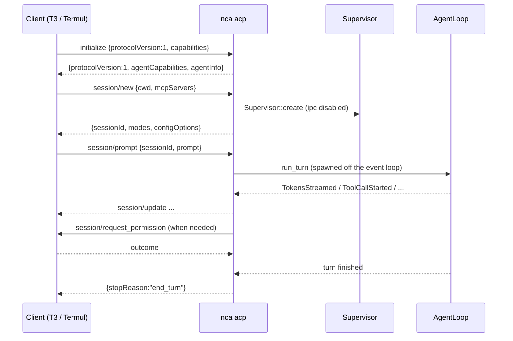

# ACP Integration: `nca acp`

Status: **implemented** in `crates/acp` + `nca acp` (ACP v1). Phases 1–3 and
the phase-4 session/compaction work are shipped; the remaining optional items
are listed at the end.

Goal: let desktop agent clients drive nca as a subprocess over the Agent Client
Protocol, without a JavaScript runtime, a second binary, a daemon, or a
meaningful increase in memory.

## What ACP is

The Agent Client Protocol (ACP) standardizes how a *client* (editor, desktop
app, mobile app) talks to a *coding agent*. It is JSON-RPC 2.0 over stdio:
newline-delimited JSON, one message per line, UTF-8, no embedded newlines.

- The client spawns the agent as a child process.
- The agent reads JSON-RPC from `stdin` and writes JSON-RPC to `stdout`.
- Anything else on `stdout` breaks the connection. `stderr` is free for logs.
- Stable protocol version is `1`. Version `2` is a draft preview.

Source: `agentclientprotocol.com/protocol/v1/*`, spec repository
`agentclientprotocol/agent-client-protocol`.

### Why this shape is a good fit

nca already speaks newline-delimited JSON in two places: the CLI's NDJSON stream
mode and the Unix-socket IPC transport. ACP is the same framing with a JSON-RPC
envelope, so the transport layer is not new work. The hard part is the mapping
from nca's `AgentEvent` stream to ACP's `session/update` variants, and the
session lifecycle.

## Client landscape

| Client | ACP support | How it launches an agent |
|---|---|---|
| T3 Code (`pingdotgg/t3code`) | `packages/provider-acp`, ACP v2 preferred, v1 negotiated | Settings → Providers → Local ACP command: executable + literal args, no shell |
| Termul (`gnoviawan/termul`) | Rust ACP client in `src-tauri/src/acp/` using `agent-client-protocol` 1.3 | `AgentConfig { command, args, env }`, arbitrary local binary |
| Zed | Native ACP | `agent_servers` entry with command + args |
| Others | Any ACP client | Same: command + args |

Both target clients accept an arbitrary local executable with arguments. That
means one entry point is enough:

```
nca acp
```

No wrapper script, no Node shim, no `npx`.

### What T3 Code expects

From `packages/provider-acp`:

- Sends `clientCapabilities` with `fs.readTextFile`, `fs.writeTextFile`,
  `terminal`, and `elicitation.form`.
- Reads `agentCapabilities.loadSession` to enable thread snapshots.
- Reads `agentCapabilities.sessionCapabilities.list` to enable **List sessions**
  and native session import.
- Reads `configOptions` for the model picker; the option with
  `category: "model"` is the model selector.
- Reads `modes` / mode config option for the Plan/Build toggle.
- Maps `session/request_permission` onto its thread permission mode.
- Uses `usage_update` for the context meter and cost metadata.
- Uses `available_commands_update` for the `/` provider command menu.
- Cancels with `session/cancel` and expects a `cancelled` stop reason.

T3 Code prefers ACP v2 and falls back to v1 when the agent answers
`protocolVersion: 1`. v1 is the correct MVP target; v2 is additive later.

### What Termul expects

`AgentConfig` is `{ name, command, args, env, allow_terminal }`. Terminal access
is opt-in per agent. The client is the same Rust crate family, so schema
conformance is shared.

## Protocol surface for v1

Required to be useful; everything else is optional.

| Method | Direction | Notes |
|---|---|---|
| `initialize` | client → agent | Negotiate version + capabilities |
| `session/new` | client → agent | `cwd`, `mcpServers`, optional `additionalDirectories` |
| `session/prompt` | client → agent | Content blocks; returns `stopReason` |
| `session/cancel` | client → agent | Notification, no response |
| `session/update` | agent → client | Streaming chunks, tool calls, plan, usage |
| `session/request_permission` | agent → client | Approval |
| `session/load` | client → agent | Replay history, then respond |
| `session/list` | client → agent | Native session discovery |
| `session/delete` | client → agent | Remove a listed session and its files |
| `session/set_mode` | client → agent | Legacy mode switch |
| `session/set_config_option` | client → agent | Model / mode / options |

`session/update` variants we will emit:

| Variant | Source |
|---|---|
| `agent_message_chunk` | `AgentEvent::TokensStreamed` |
| `agent_thought_chunk` | reasoning deltas |
| `tool_call` | `AgentEvent::ToolCallStarted` |
| `tool_call_update` | `AgentEvent::ToolCallCompleted` |
| `plan` | `AgentEvent::TodosUpdated` |
| `usage_update` | `AgentEvent::CostUpdated` |
| `current_mode_update` | mode change |
| `config_option_update` | model change |
| `available_commands_update` | slash command registry |
| `session_info_update` | `/rename`, title changes |

Stop reasons we will return: `end_turn`, `max_tokens`, `max_turn_requests`,
`cancelled`, `refusal`.

## Mapping nca internals to ACP

### Sessions

`session/new` → `Supervisor::create` with `workspace_root = cwd` and
`session_id = <acp session id>`. nca's session store already writes
`<id>.json` plus `<id>.events.jsonl`, which is exactly what `session/load`
needs to replay.

`session/load` → `Supervisor::resume`, then stream the event log as
`session/update` notifications (user chunks, agent chunks, tool calls), then
respond.

`session/list` → read `SessionStore` metadata for the requested `cwd`, return
`SessionInfo { sessionId, cwd, title, updatedAt }`.

### Prompts

`session/prompt` → `Supervisor::run_turn`. The turn runs off the JSON-RPC event
loop so `session/cancel` is still processed; the `session/prompt` response is
sent when the turn future resolves.

Content blocks: text maps to the prompt string. `resource_link` and `resource`
become file mentions or inlined text. Images map onto nca's existing
`ImageAttachment` path, so `promptCapabilities.image` can be advertised.

### Approvals

`ApprovalHandler` already exists and is already injectable through
`SupervisorConfig::approval_handler`. Add an `AcpApprovalHandler` that sends
`session/request_permission` and awaits the response, mapping:

| ACP option kind | nca verdict |
|---|---|
| `allow_once` | `Approved` |
| `allow_always` | `Approved` + remember for this session |
| `reject_once` | `Denied` |
| `reject_always` | `Denied` + remember |
| `cancelled` outcome | turn cancelled |

This is the cleanest seam in the whole design: no changes to the agent loop.

### Tool calls

`ToolCallStarted { call_id, tool, input }` → `tool_call` with `toolCallId`,
`title`, `name`, `kind`, `status: "pending"`, `rawInput`.

`ToolCallCompleted { call_id, output }` → `tool_call_update` with
`status: "completed"` (or `"failed"`), `content: [{ type: "content", ... }]`,
`rawOutput`.

Kind mapping:

| nca tool | ACP kind |
|---|---|
| `read_file`, `list_directory`, `git_status`, `git_diff` | `read` |
| `write_file`, `edit_file`, `apply_patch`, `replace_match`, `create_directory` | `edit` |
| `delete_path` | `delete` |
| `move_path`, `rename_path`, `copy_path` | `move` |
| `search_code`, `query_symbols` | `search` |
| `execute_bash`, `run_validation` | `execute` |
| `web_search`, `fetch_url` | `fetch` |
| `update_todos` | `think` |
| everything else | `other` |

File-modifying calls include `locations` so the client can open the edited file.

### Plans and todos

`update_todos` already keeps an authoritative `Vec<AgentTodo>` and emits
`TodosUpdated`. Map each todo to a plan entry with `status` in
`pending | in_progress | completed` and a priority derived from order.

### Questions

The `ask_question` tool emits `QuestionRequested` and blocks on a oneshot. Two
options:

1. ACP `elicitation/create` when the client advertises `elicitation.form`.
2. Fallback: auto-select `suggested_answer` and emit a notice.

Elicitation is a phase 2 item; the fallback keeps the tool usable from day one.

### Modes and config

nca permission modes map onto ACP modes:

| nca mode | ACP mode id | Label |
|---|---|---|
| `plan` | `plan` | Plan |
| `default` | `ask` | Ask |
| `accept-edits` | `accept-edits` | Accept edits |
| `dont-ask` | `dont-ask` | Don't ask |
| `bypass-permissions` | `bypass` | Bypass |

Also expose `configOptions`:

- `mode` (`category: "mode"`, select) for clients that prefer config options.
- `model` (`category: "model"`, select) listing configured models. On
  `session/set_config_option` with `configId: "model"`, apply
  `NcaConfig::apply_model_override` and rebuild the provider.

T3 Code reads the model from the `model` category, so this is what makes the
model picker work.

### Usage

`CostUpdated { input_tokens, output_tokens, estimated_cost_usd }` plus
`ContextManager` stats become `usage_update` with `used`, `size`, and
`cost: { amount, currency: "USD" }`. This drives T3 Code's context meter.

## Proposed architecture

New crate `nca-acp`, one new subcommand, no new binary.

```
crates/acp/
  Cargo.toml
  src/lib.rs          // run(): SDK builder, handler registration, stdio transport
  src/server.rs       // JSON-RPC handlers, session registry, idle eviction
  src/session.rs      // SessionSlot: supervisor lifecycle, event pump + coalescing
  src/translate.rs    // AgentEvent -> session/update
  src/options.rs      // session modes + configOptions (mode, model)
  src/approval.rs     // AcpApprovalHandler
  src/history.rs      // session/load replay from events.jsonl
```

There is no separate writer module: token coalescing lives in the event pump
in `session.rs` (16 ms / 256 bytes, plus a flush barrier before the prompt
response).

Dependency direction:

```
cli -> acp -> runtime -> core -> common
```

`nca acp` in `crates/cli/src/main.rs`:

```rust
Command::Acp { model, safe, permission_mode } => nca_acp::run(config, options).await?
```

### Why a separate crate

- Keeps ACP types and translation out of `cli`, which is already 1.9k lines.
- Lets the ACP surface be tested without a terminal or TUI.
- Matches the existing crate-per-concern convention.
- No new binary: `nca-cli` depends on it.

### Why not reuse `nca serve` + IPC

That would put two processes between the client and the agent: the ACP bridge and
the service session. Each process costs a runtime, a socket, and a duplicate
session state. It also makes cancellation a three-hop path. Running the agent
in-process is both simpler and smaller.

### Changes to existing crates

| Change | Reason |
|---|---|
| `SupervisorConfig::enable_ipc: bool` (default `true`) | ACP does not need a Unix socket per session |
| `Supervisor::create` skips `IpcServer` when disabled | Avoids socket file + listener task per session |
| `Supervisor::resume` takes the same flag | Same |
| Public `Supervisor::event_tx()` already exists | Reuse for subagent events |
| No changes to `AgentLoop`, tools, or providers | The seams already exist |

Everything else is additive.

## Session lifecycle



## Memory budget

Baseline measured on this machine (README, 0.5.0 build): **6.4 MB** macOS
footprint for a short one-shot run.

Target for `nca acp`:

| State | Target |
|---|---|
| Idle after `initialize`, no session | ≤ 8 MB |
| One live session, idle | ≤ 10 MB |
| One live session, streaming | ≤ 14 MB |
| Each additional live session | +1–3 MB |
| Cold start to `initialize` response | < 100 ms |

### Measured (release build, macOS, physical footprint)

| State | Footprint | RSS |
|---|---|---|
| After `initialize`, no session | 3.5 MB | 11.1 MB |
| One live session, idle | 4.8 MB | 15.1 MB |
| Streaming a reply (peak) | 5.2 MB | 16.0 MB |
| After 10 turns | 5.6 MB | 16.4 MB |
| 3 live sessions | 5.7 MB | 16.5 MB |
| 5 sessions opened, 3 live after eviction | 5.8 MB | 16.6 MB |

Footprint varies by about ±0.2 MB between runs. Every target is met on
footprint. RSS is higher because it counts shared
library pages that are not resident-private memory; use `footprint` for
comparisons with the README figure. Eviction is doing its job: opening two more
sessions after the third adds ~0 MB because the oldest supervisors are saved and
dropped.

### Tactics

1. **One process.** No daemon, no bridge, no IPC socket per session. The client
   already owns the process boundary.
2. **No TUI in the path.** `nca acp` never initializes ratatui, never enters the
   alternate screen, never runs a render loop. That removes the 60 FPS draw
   budget and the transcript buffer that the TUI keeps.
3. **Coalesce token deltas.** `TokensStreamed` fires once per model delta. Emit
   at most one `agent_message_chunk` per ~16 ms or ~256 bytes, whichever comes
   first. This cuts JSON serialization and syscalls by an order of magnitude
   during streaming, and keeps the writer's buffer bounded.
4. **Bounded channel with backpressure.** Reuse the existing `mpsc::channel(256)`
   between agent and writer. If the client stalls, the agent blocks instead of
   buffering the whole response.
5. **No duplicate transcript.** The ACP session state *is* the nca session. Do
   not keep a second `Vec<Message>` for ACP. `session/load` streams the JSONL
   log line by line and drops each line after translating it.
6. **Idle session eviction.** Keep at most 2 live `Supervisor`s by default
   (configurable). Others are saved and dropped; the next prompt resumes them
   from disk. This bounds memory when a desktop client opens many threads.
7. **Lazy MCP.** MCP tools are discovered per session. Do not preload every
   configured server at `initialize`; connect on first `session/new` that
   needs them, and drop connections on eviction.
8. **No history clone per turn.** Verify `run_turn` does not clone `messages`
   on the hot path. `snapshot()` clones, so it must not be called per token.
9. **Release profile stays `opt-level = 3`, thin LTO, strip, panic=abort.**
   Do not add `opt-level = "z"`; it trades speed for a smaller binary that is
   already 11 MB and not the RAM bottleneck.
10. **No new runtime.** Use the existing tokio runtime. The ACP SDK's stdio
    transport uses one blocking reader thread, not a second executor.

### What to measure

- RSS/footprint at: after `initialize`, after `session/new`, mid-stream, after
  10 turns, with 3 sessions open, after eviction.
- Compare against `nca --prompt` and against `nca serve`.
- Track cold start with `hyperfine` and first-response latency from a scripted
  client.

## Compatibility gotchas

These are the failure modes that will break a client if missed.

1. **stdout purity.** Nothing but JSON-RPC may reach stdout. Today `tracing`
   writes to stderr (good), but `println!` is used in many CLI subcommands.
   `nca acp` must not touch those paths, and the ACP writer must be the only
   writer to stdout.
2. **Never prompt on stdin.** `stdin` is the JSON-RPC channel. Missing API key,
   onboarding, and approval prompts must not read it. A missing key must return
   a JSON-RPC error (`auth_required` or `internal_error`), not hang.
3. **No interactive onboarding.** `nca acp` skips `NcaConfig::load()`'s
   interactive paths and the API key modal.
4. **Cancel must not be blocked.** The prompt turn runs off the event loop, so
   `session/cancel` is handled while the model is streaming. Set the existing
   `cancel_flag` and return `stopReason: "cancelled"` — never an error response.
5. **Permission requests must be answerable during a turn.** The approval
   handler awaits a oneshot; the JSON-RPC loop must keep dispatching while it
   waits.
6. **One `session/prompt` at a time per session.** Reject a second concurrent
   prompt on the same session with an error, or queue it. Do not interleave.
7. **`session/load` must replay before responding.** T3 Code treats the
   `session/load` response as "history is complete".
8. **Paths.** `cwd` is absolute and is the sandbox root. Canonicalize it once at
   `session/new`; do not trust client paths afterwards.
9. **Auth.** Registry agents are expected to advertise an auth method. For the
   registry listing, advertise a terminal or env-var API key method; for local
   commands, an empty `authMethods` array is fine.
10. **Version negotiation.** If the client sends `2`, answer `1` and implement
    v1. Do not claim v2.

## Implementation phases

Phases 1–3 are complete. Each exit criterion is covered by
`crates/cli/tests/acp_stdio.rs`, which drives the real `nca acp` binary over
pipes.

### Phase 1 — skeleton and handshake

**Status: done.**

- New crate `nca-acp` with `Agent.builder()` over `Stdio`.
- `initialize` with `protocolVersion: 1`, `agentInfo`, capabilities
  (`loadSession`, `sessionCapabilities.list`, `promptCapabilities.image`).
- `session/new` → `Supervisor::create` with IPC disabled.
- `session/prompt` → `run_turn`, translate message chunks only.
- `session/cancel`.
- `nca acp` subcommand, hidden from the main help until it works.

Exit criterion: a scripted client completes one turn and sees streamed text.

### Phase 2 — tools, approvals, usage

**Status: done.**

- Tool call translation with kinds, titles, locations.
- `AcpApprovalHandler` + permission options.
- `usage_update` from cost and context stats.
- `plan` from todos.
- Coalescing writer.

Exit criterion: T3 Code shows tool cards, asks for approval, and shows the
context meter.

### Phase 3 — sessions and configuration

**Status: done.**

- `session/load` with history replay.
- `session/list`.
- `session/delete` (state JSON + event log; a running prompt blocks it).
- `session_info_update` on `/rename`.
- `modes` + `configOptions` (mode, model).
- `session/set_mode`, `session/set_config_option`.
- Slash command advertisement (`/compact`, `/rename`, `/model`, `/mode`).

Exit criterion: T3 Code imports an nca session, switches model and mode.

### Phase 4 — polish

**Status: done except three optional items.** Implemented: `elicitation/create`,
idle session eviction, `session/delete`, `available_commands_update`,
`session_info_update`, `compaction_update`, and docs
(`docs/documentation/acp.md`, README, tech-stack). Remaining: client `fs/*`
capability for unsaved buffers, ACP registry entry, ACP v2.

- `elicitation/create` for `ask_question`.
- Idle session eviction.
- `session/delete` and slash-command/title/compaction updates.
- Client `fs/*` capability for unsaved buffers (optional).
- ACP registry entry (`distribution.binary` per platform, `args: ["acp"]`).
- Docs: `docs/documentation/acp.md`, README section, `docs/tech-stack.md`
  dependency entry.
- Optional: ACP v2 behind a feature flag.

## Test plan

Implemented:

- `crates/acp` unit tests: tool-kind mapping, tool titles/locations, update
  serialization, output truncation, plan mapping, usage/cost, mode round-trips,
  and `configOptions`.
- `crates/cli/tests/acp_stdio.rs`: handshake, `session/new` modes + model, a
  full streamed turn against a mock provider, tool calls with kinds and
  locations, `session/request_permission` → allow → tool runs, missing API key
  failing loudly without touching stdin, cancel → `cancelled` (and the session
  staying usable), `session/load` history replay across processes, and
  `session/list`, `session/delete`, available commands, `/rename`, and
  `/compact`, plus an end-to-end coalescing check (many small deltas arrive as
  fewer chunks with no text lost).
- `crates/runtime`: resuming a session keeps exactly one system prompt at the
  front of the history.
- `crates/core`: the task anchor survives eviction, the current request is never
  truncated, and a system-prompt refresh keeps an auto-summary.

Still open:

**Unit**

- Golden files for each JSON-RPC message shape.
- Coalescing writer: the byte threshold and no-text-loss path are covered
  end-to-end; a deterministic unit test for the 16 ms timer is still open.

**Interop**

- T3 Code: add as Local ACP command, run a turn, approve a tool, cancel,
  list sessions, switch model.
- Termul: add `AgentConfig { command: "nca", args: ["acp"] }`, same checklist.
- Zed, if available.

**Memory**

- Sampling is done (see the measured table above). Repeat it with
  `footprint <pid>` after `initialize`, `session/new`, mid-stream, after 10
  turns, and after eviction.
- Regression gate: `nca acp` idle must stay under 10 MB. Not automated because
  the measurement is platform-specific.

## Open questions

1. **SDK vs hand-rolled JSON-RPC** — decided: ship the SDK
   (`agent-client-protocol` 3.6, `stdio`). Typed schema and dispatch are worth
   the extra crates, and the binary is still single-process.
2. **Client `mcpServers` vs nca's own MCP config** — deferred. `session/new`
   accepts the field but nca uses its own config today. Merging needs a
   name-collision policy and a per-session MCP lifecycle.
3. **Default permission mode** — decided: the config's mode (normally `ask`),
   overridable with `--permission-mode` and the client's mode picker.
4. **`session/delete`** — decided: implement it. A running prompt blocks the
   delete, the supervisor is dropped without saving, and the state JSON plus
   event log are removed. Worktrees are left alone.
5. **Subagents** — decided: keep `spawn_subagent` enabled. Children stay nca
   sessions with lineage metadata; ACP only sees the parent turn's tool calls.

## Sources

- ACP docs: `agentclientprotocol.com/protocol/v1/*`
- ACP schema: `agentclientprotocol/agent-client-protocol` (`schema/v1`)
- Rust SDK: crates.io `agent-client-protocol` 3.6.0
- T3 Code: `pingdotgg/t3code`, `packages/provider-acp`, `docs/user/providers-acp.md`
- Termul: `gnoviawan/termul`, `src-tauri/src/acp/`
- ACP Registry: `agentclientprotocol/registry`, `agent.schema.json`
